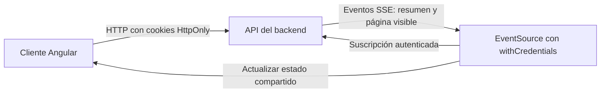

# VMS Manager — Frontend

Interfaz para consultar y administrar máquinas virtuales. Angular 20 standalone,
Angular Material, TypeScript estricto y SCSS. El backend mantiene la autenticación,
los permisos y la persistencia; el navegador no se conecta directamente a Firebase.

## Arranque desde cero

### Requisitos

- Node.js **22.18.0** y npm; la versión está fijada en `.nvmrc`.
- API del backend disponible en `http://localhost:3000`. Su instalación y
  configuración están en el [README del backend](../ifx-back/README.md).
- Google Chrome para ejecutar las pruebas con ChromeHeadless.

### Instalación y ejecución

Desde la raíz de este repositorio, si usas nvm:

```sh
nvm install
nvm use
```

nvm es opcional: también puedes instalar esa versión de Node directamente.

```sh
npm ci
npm start
```

Abre **http://localhost:4200**. Usa `localhost` también para el API: no alternes
con `127.0.0.1`, porque cambia el origen y el host de las cookies.

La URL pública del API se centraliza en
[`src/app/core/auth/api.config.ts`](src/app/core/auth/api.config.ts), mediante
`API_BASE_URL`. Para otro despliegue, reemplaza ese provider. El frontend no
requiere un `.env` local ni credenciales privadas. Producción requiere HTTPS.

## Usuarios de demostración

Estas credenciales fueron proporcionadas para la prueba técnica. Los usuarios
deben estar habilitados en el API; el frontend no los crea automáticamente.

| Rol | Email | Contraseña de demostración |
| --- | --- | --- |
| ADMINISTRADOR | `adminprueba@example.com` | `admin1234567` |
| CLIENTE | `clienteprueba@example.com` | `cliente123456` |

Son cuentas de demostración, no credenciales de producción. Ambos roles consultan
máquinas; solo ADMINISTRADOR puede crear, editar y eliminar.

Para usar ambos usuarios simultáneamente, abre perfiles de navegador independientes
(o un perfil normal y una ventana privada). Las pestañas del mismo perfil comparten
cookies. Un login o logout exitoso se anuncia a las otras pestañas: cierran el
inventario anterior y consultan la sesión actual por cookies antes de navegar a
Dashboard o login. Así también se refleja un cambio de cuenta entre pestañas.

## Pantallas y comportamiento

- **`/login`:** autenticación por cookies HttpOnly. Ante credenciales rechazadas,
  conserva email y contraseña y muestra un mensaje genérico. El JWT nunca se lee
  en JavaScript ni se guarda en localStorage/sessionStorage.
- **`/dashboard`:** entrada después del login, con conteos globales por estado y
  gráficos de recursos asignados a todas las VMs RUNNING.
- **`/vms`:** inventario en tarjetas, paginado de **10 en 10** por cursores del
  servidor. El filtro es por estado; cambiarlo vuelve a la primera página. No hay
  búsqueda local por nombre o sistema operativo.
- **Crear/editar:** nombre y sistema operativo hasta 100 caracteres; espacios
  normalizados y cada palabra con inicial mayúscula y resto minúsculas. Cores
  entero de 1 a 999; RAM y disco positivos hasta 999 GB, admitiendo decimales.
  Los inputs de recursos son texto y se convierten a números antes del envío.
  `PUT` envía siempre los seis campos completos.
- **Mutaciones:** actualización optimista de la tarjeta afectada y rollback si
  falla el API. Eliminar exige confirmación. Los gráficos usan totales confirmados
  y no suman la página visible ni los cambios optimistas pendientes.
- **Feedback:** skeletons por vista, estados vacíos y de error, notificaciones,
  spinners de envío y resaltado temporal de cambios remotos.
- **Diseño:** temas claro/oscuro, logos originales y fuentes locales Sora y
  JetBrains Mono. Layout responsive desde **280 px**, filtros con scroll horizontal
  y animaciones que respetan movimiento reducido.

Los gráficos separan cores, RAM y disco en sus propias unidades. Representan
**recursos asignados**, no consumo de CPU/memoria en tiempo real ni porcentajes de
capacidad.

## Sesión y actualizaciones en tiempo real

La sesión pública vive en memoria. Al recargar, el guard la restaura mediante
`POST /refresh`. Un 401 del API permite una renovación compartida y un único
reintento. Web Locks coordina login/refresh/logout entre pestañas cuando está
disponible; el fallback coordina dentro de la instancia. La restauración y el
logout muestran una pantalla completa de carga; un logout fallido no se informa
como exitoso.

BroadcastChannel comunica cambios de sesión entre pestañas. Como fallback se usa
un evento storage efímero, con solo versión, acción y nonce; nunca identidad,
contraseñas ni tokens. Refresh no publica eventos, evitando bucles. Web Locks
serializa las operaciones con cookies cuando el navegador ofrece esa API; sin ella
la coordinación de peticiones sigue siendo por instancia.



El frontend recibe los eventos del API mediante `EventSource` con
`withCredentials: true`. Hay una conexión por vista: Dashboard escucha el resumen;
VMs escucha el resumen y la ventana paginada visible.

Las suscripciones se cierran al navegar, salir o destruir el shell. La revisión
del resumen y `readVersion` de la página descartan snapshots antiguos. Las dos
fuentes son independientes: no se presentan como un evento conjunto atómico.
Tras tres fallos de reconexión, la interfaz ofrece **Reconectar**.

## Decisiones técnicas y organización

| Herramienta | Uso en este proyecto |
| --- | --- |
| Angular standalone | Componentes por feature, rutas lazy, DI y formularios tipados sin módulos innecesarios. |
| Angular Material | Controles, diálogos y menús accesibles; tema mediante APIs públicas y tokens compartidos. |
| Chart.js | Gráficos pequeños por unidad para los totales globales de recursos asignados. |
| Signals | Estado local y estado de VMs compartido por el shell, sin duplicarlo en otra capa. |
| RxJS | Peticiones HTTP, cancelación y coordinación de flujos asíncronos. |

```text
src/app/
├── app.config.ts / app.routes.ts  # Composición global y rutas
├── core/
│   ├── auth/                     # API, sesión, guard, interceptor y coordinación
│   └── theme.service.ts          # Preferencia visual
├── features/
│   ├── auth/                     # Login
│   └── vms/                      # DashboardShell, Dashboard, inventario,
│                                 # servicio, SSE, modelos, formulario y gráficos
└── shared/                       # Feedback, confirmación, skeletons,
                                  # carga completa, tema y spinner
src/styles/                       # Tokens y theming Material
public/                           # Logos, fondos y favicons
```

`VmsService` se provee en `DashboardShell` y se comparte entre Dashboard y VMs.
Los componentes coordinan presentación; los servicios gestionan datos y estado.
No se añaden repositories, wrappers ni stores duplicados para esta escala.

[DESIGN.md](DESIGN.md) define la identidad visual.
[AGENTS.md](AGENTS.md) y `.codex/agents/` documentan las convenciones, revisiones y
checkpoints del proyecto.

## Pruebas y validaciones

```sh
npm run typecheck
npm run build
npm run test:ci
npm audit --omit=dev
```

Karma/Jasmine, TestBed y HttpTestingController aíslan dependencias; las pruebas no
requieren usuarios reales ni un API en ejecución. `test:ci` usa ChromeHeadless.
Si Chrome no se detecta automáticamente, configura `CHROME_BIN` según tu sistema.

macOS:

```sh
CHROME_BIN='/Applications/Google Chrome.app/Contents/MacOS/Google Chrome' npm run test:ci
```

Linux (ajusta la ruta si usas Chromium):

```sh
CHROME_BIN=/usr/bin/google-chrome npm run test:ci
```

Windows PowerShell (ajusta la ruta a tu instalación):

```powershell
$env:CHROME_BIN = 'C:\Program Files\Google\Chrome\Application\chrome.exe'
npm run test:ci
```

`npm test` inicia el runner interactivo. No hay lint configurado.

## Bitácora de IA

- **Herramientas:** Codex (OpenAI), con agentes de frontend, diseño y QA.
- **Trabajo delegado:** login, dashboard, CRUD optimista, gráficos Chart.js,
  conexión SSE, pruebas y documentación.
- **Intervención humana:** definición de la identidad visual y aporte de logos,
  fondos, paleta y tipografías; revisión de las pantallas y ajustes de navegación,
  confirmaciones, formularios, estados de carga y responsive hasta 280 px.

### Prompt utilizado

Prompt utilizado para la estructura inicial.

<details>
<summary>Ver prompt de arquitectura inicial</summary>

```text
Prompt arquitectura inicial front end
Vamos a comenzar la estructuración del frontend de la prueba técnica.
El frontend estará en el folder hermano:
ifx-front
Será desarrollado con Angular utilizando Standalone Components.
En esta primera etapa quiero enfocarme únicamente en establecer las bases arquitectónicas, de diseño y de desarrollo del proyecto.
No implementes ninguna feature ni lógica funcional todavía.
1. Arquitectura
Utiliza una arquitectura Feature-based, sencilla y mantenible, adecuada para el tamaño de esta prueba técnica.
La estructura debe permitir que cada feature pueda crecer de forma independiente sin generar acoplamiento innecesario.
Utiliza:
Angular Standalone Components.
Feature-based architecture.
Servicios desacoplados.
Dependency Injection.
NgRx para estado global cuando realmente sea necesario.
Angular Material como librería principal de componentes UI.
No sobreingenierices la estructura. Debe ser simple y clara.
2. AGENTS.md
Utiliza como referencia conceptual el AGENTS.md que creamos para el backend y crea un equivalente específico para el frontend.
Debe definir las reglas de desarrollo del frontend, incluyendo:
Arquitectura.
Organización de carpetas.
Convenciones.
Componentes.
Servicios.
Estado.
NgRx.
Testing.
Manejo de errores.
Código limpio.
Reutilización.
Dependencias.
Calidad.
No copies literalmente el documento del backend. Adáptalo a Angular y a las necesidades del frontend.
3. DESIGN.md
Crea un archivo:
DESIGN.md
Este será la guía de diseño del proyecto y deberá convertirse en la referencia principal para mantener consistencia visual.
Por ahora debe establecer la estructura de la guía, incluyendo:
Design principles.
Theme.
Color palette.
Typography.
Spacing.
Borders / radius.
Elevation.
Component guidelines.
Forms.
Buttons.
Feedback states.
Responsive behavior.
Accessibility.
Layout conventions.
Todavía no definas una identidad visual completa si no tenemos los requisitos suficientes.
Deja la estructura preparada para que posteriormente podamos definir nuestra paleta, tipografía y demás decisiones visuales.
4. Angular Material
Configura Angular Material como nuestra librería principal de componentes UI.
La intención es aprovechar componentes existentes siempre que sea razonable en lugar de construirlos desde cero.
El proyecto debe utilizar un theme propio que posteriormente podamos extender con nuestra identidad visual.
Prepara la estructura necesaria para manejar:
Theme.
Colores.
Typography.
Component customization.
Evita personalizaciones innecesarias por ahora.
5. NgRx
Deja preparado el proyecto para utilizar NgRx como solución de estado global.
Importante:
No agregues stores, actions, reducers, effects o selectors de features que todavía no existen.
NgRx deberá utilizarse únicamente cuando exista estado que realmente necesite ser global o compartido.
No utilizar NgRx para cualquier estado local de un componente.
6. Agentes
Define en AGENTS.md los siguientes roles:
Senior Frontend Engineer
Responsable de:
Arquitectura.
Implementación.
Angular.
Componentes.
Servicios.
Estado.
Mantenibilidad.
Calidad del código.
Senior QA Engineer
Responsable de revisar:
Funcionalidad.
Regresiones.
Tests.
Integridad de componentes.
Estados.
Responsive behavior cuando corresponda.
Calidad general.
Senior Web Designer
Responsable de revisar:
Consistencia visual.
UX.
UI.
Design system.
Uso correcto de Angular Material.
Responsive design.
Accesibilidad.
Consistencia con DESIGN.md.
7. Calidad de código
Durante todo el desarrollo deben respetarse las buenas prácticas de ingeniería que ya establecimos para el backend.
Aplica cuando corresponda:
Clean Code.
SOLID.
DRY.
Design Patterns.
Separation of Concerns.
Dependency Injection.
No introduzcas patrones o abstracciones únicamente para aumentar la complejidad.
La solución debe ser proporcional a la prueba técnica.
8. Estructura inicial
Inspecciona el estado actual de ifx-front antes de modificarlo.
Después crea únicamente la estructura base necesaria para soportar la arquitectura definida.
No crees todavía:
Features.
Pages funcionales.
Componentes de negocio.
Stores de negocio.
Servicios específicos de negocio.
Modelos relacionados con funcionalidades aún no definidas.
Deja preparada únicamente la foundation del proyecto.
9. Validación
Al finalizar:
Verifica que Angular compile correctamente.
Ejecuta lint si está configurado.
Ejecuta los tests disponibles.
Verifica que Angular Material esté correctamente configurado.
Verifica que la estructura sea consistente.
Verifica que AGENTS.md y DESIGN.md estén alineados con la arquitectura.
No agregues dependencias innecesarias.
Checkpoint 0
Al terminar presenta:
CHECKPOINT 0 — FRONTEND FOUNDATION

Architecture:
- ...

Project structure:
- ...

AGENTS.md:
- ...

DESIGN.md:
- ...

Angular Material:
- ...

NgRx:
- ...

Agents:
- ...

Validation:
- ...

Issues:
- ...

STATUS:
WAITING FOR USER APPROVAL
Después del checkpoint, detente y espera mi aprobación explícita.
No implementes ninguna feature hasta que te indique cuál debemos desarrollar primero.
```

</details>
